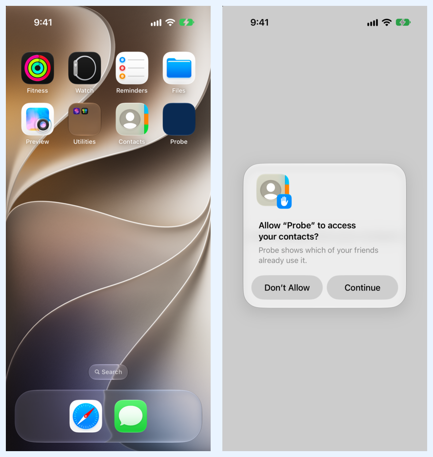

<!-- i18n-source: README.md@6156987af1dcda58a7bd3220ac4f8dc2c4c989aa status=reviewed -->
<!-- brand:start -->

<p align="center"><picture><source media="(prefers-color-scheme: dark)" srcset="https://raw.githubusercontent.com/muhittincamdali/reviewready/main/.github/brand/banner-dark.svg"><source media="(prefers-color-scheme: light)" srcset="https://raw.githubusercontent.com/muhittincamdali/reviewready/main/.github/brand/banner-light.svg"></picture></p>

<!-- lang-selector:start -->
<p align="center"><a href="README.md">English</a> · <a href="README.tr.md">Türkçe</a> · <a href="README.zh-CN.md">简体中文</a> · <a href="README.ja.md">日本語</a> · <a href="README.ko.md">한국어</a> · <a href="README.es.md">Español</a> · <a href="README.de.md">Deutsch</a> · <a href="README.fr.md">Français</a> · <a href="README.pt-BR.md">Português (Brasil)</a> · <a href="README.ru.md">Русский</a></p>
<!-- lang-selector:end -->

<p align="center">
<a href="https://github.com/muhittincamdali/reviewready/actions/workflows/ci.yml"></a>
<a href="https://github.com/muhittincamdali/reviewready/releases"><picture><source media="(prefers-color-scheme: dark)" srcset="https://raw.githubusercontent.com/muhittincamdali/reviewready/main/.github/brand/badge-version-dark.svg"><source media="(prefers-color-scheme: light)" srcset="https://raw.githubusercontent.com/muhittincamdali/reviewready/main/.github/brand/badge-version-light.svg"></picture></a>
<a href="https://github.com/muhittincamdali/reviewready/blob/main/package.json"><picture><source media="(prefers-color-scheme: dark)" srcset="https://raw.githubusercontent.com/muhittincamdali/reviewready/main/.github/brand/badge-language-dark.svg"><source media="(prefers-color-scheme: light)" srcset="https://raw.githubusercontent.com/muhittincamdali/reviewready/main/.github/brand/badge-language-light.svg"></picture></a>
<a href="https://github.com/muhittincamdali/reviewready/blob/main/LICENSE"><picture><source media="(prefers-color-scheme: dark)" srcset="https://raw.githubusercontent.com/muhittincamdali/reviewready/main/.github/brand/badge-license-dark.svg"><source media="(prefers-color-scheme: light)" srcset="https://raw.githubusercontent.com/muhittincamdali/reviewready/main/.github/brand/badge-license-light.svg"></picture></a>
</p>

<p align="center">
<a href="#schnellstart"><picture><source media="(prefers-color-scheme: dark)" srcset="https://raw.githubusercontent.com/muhittincamdali/reviewready/main/.github/brand/button-start-de-dark.svg"><source media="(prefers-color-scheme: light)" srcset="https://raw.githubusercontent.com/muhittincamdali/reviewready/main/.github/brand/button-start-de-light.svg"></picture></a>
<a href="https://muhittincamdali.github.io/reviewready/"><picture><source media="(prefers-color-scheme: dark)" srcset="https://raw.githubusercontent.com/muhittincamdali/reviewready/main/.github/brand/button-docs-de-dark.svg"><source media="(prefers-color-scheme: light)" srcset="https://raw.githubusercontent.com/muhittincamdali/reviewready/main/.github/brand/button-docs-de-light.svg"></picture></a>
<a href="https://github.com/muhittincamdali/reviewready/tree/main/docs/guides"><picture><source media="(prefers-color-scheme: dark)" srcset="https://raw.githubusercontent.com/muhittincamdali/reviewready/main/.github/brand/button-guides-de-dark.svg"><source media="(prefers-color-scheme: light)" srcset="https://raw.githubusercontent.com/muhittincamdali/reviewready/main/.github/brand/button-guides-de-light.svg"></picture></a>
<a href="https://github.com/muhittincamdali/reviewready/tree/main/examples"><picture><source media="(prefers-color-scheme: dark)" srcset="https://raw.githubusercontent.com/muhittincamdali/reviewready/main/.github/brand/button-examples-de-dark.svg"><source media="(prefers-color-scheme: light)" srcset="https://raw.githubusercontent.com/muhittincamdali/reviewready/main/.github/brand/button-examples-de-light.svg"></picture></a>
</p>

> Dies ist eine Übersetzung der englischen README. Bei Abweichungen gilt die englische Fassung.

<!-- brand:end -->

Ablehnungen durch App Review, die die Dateien eines Projekts bereits verraten (eine fehlende Zweckbeschreibung (Purpose String), ein App-Store-Icon mit Alphakanal, ein Xcode, der älter ist als das, was App Store Connect seit dem 28. April 2026 akzeptiert), lassen sich schon in CI abfangen, bevor du einreichst. reviewready liest ein natives iOS-, Flutter- oder React-Native/Expo-Projekt und listet sie auf, jeweils mit der Apple-Seite, auf die sie sich stützen, und der Lösung für deine Art von Projekt. Es ist ein deterministisches CLI mit Regel-IDs und Exit-Codes: keine KI-Vermutungen, kein Konto, kein Upload. Es liest die Dateien deines Projekts; es baut, startet oder verändert nichts.

<picture><source media="(prefers-color-scheme: dark)" srcset="docs/media/demo-native-rejected-dark.svg"><source media="(prefers-color-scheme: light)" srcset="docs/media/demo-native-rejected-light.svg"></picture>

<sub>Aufgezeichnet mit dem echten CLI am <a href="fixtures/native-swiftui-rejected">Fixture native-swiftui-rejected</a>, einer für die Tests geschriebenen SwiftUI-App mit einem Problem pro Regel (<code>npm run demo</code>).</sub>

## Highlights

- **Jede Regel nennt ihre Quelle.** Die Regeln sind Daten ([rules/app-review.json](rules/app-review.json)), die auf Apples Dokumentation, die App Review Guidelines und Apples Seite Upcoming Requirements verlinken, gelesen am 28. Oktober 2026; die Tests schlagen fehl, wenn eine Regel keine Apple-Quelle hat oder eine Anleitung nennt, die es nicht gibt.
- **Zweckbeschreibungen nach dem, was die App wirklich nutzt.** Die APIs, die ihr Swift- und Objective-C-Code aufruft, 15 Flutter- und 10 npm-Pakete (mit dem Schlüssel, den die README des jeweiligen Pakets verlangt), die Berechtigungen, die ein Podfile für permission_handler und react-native-permissions einkompiliert, und was die Config-Plugins von Expo schreiben, einschließlich ihrer Standardtexte.
- **Im Simulator geprüft.** Ohne `NSContactsUsageDescription` stürzt unsere Test-App im iOS 27.0 Simulator mit der Meldung des Systems ab; mit der Lösung, die reviewready angibt, zeigt sie die Berechtigungsabfrage. Aufzeichnung und Screenshots liegen im Repository.
- **Die Lösung für deine Art von Projekt.** Info.plist, Build-Setting oder app.json, mit einer Anleitung pro Regelbereich.
- **Gemacht für CI.** Berichte als Terminal-Ausgabe, Klartext, Markdown und JSON, eine Liste jeder Prüfung mit ihrem Ergebnis (gefunden, bestanden, nicht geprüft, ignoriert), `--ignore` pro Regel und Exit-Codes: 0 sauber, 1 Befunde, 2 Fehler bei der Verwendung.

## Schnellstart

**1. Installiere reviewready.** Du brauchst [Node.js](https://nodejs.org/) 22.12 oder neuer (`node --version` zeigt die Version an; auf einem Mac installiert `brew install node` es). Installiere dann das Paket aus seinem [GitHub-Release](https://github.com/muhittincamdali/reviewready/releases):

```sh
npm i -g https://github.com/muhittincamdali/reviewready/releases/download/v0.1.1/reviewready-0.1.1.tgz
```

**2. Öffne ein Terminal im Ordner deiner App**, in dem die `.xcodeproj`, `pubspec.yaml` oder `package.json` liegt:

```sh
cd path/to/YourApp
```

**3. Starte reviewready:**

```sh
reviewready
```

Fang mit den **ERROR**-Befunden an: App Review oder App Store Connect weisen diese ab. Danach kommen die **WARNING**-Befunde, die App Review beanstanden kann. Jeder Befund nennt seine Lösung in der Liste „How to fix“ und verlinkt die Apple-Seite, aus der er stammt.

Homebrew installiert dasselbe Paket zusammen mit Node.js: `brew install muhittincamdali/tap/reviewready`. Die npm-Registry (`npx @mcamdali/reviewready`) ist geplant.

## Was reviewready prüft

| Regel  | Schweregrad | Befund                                                                                                                                | Quelle         |
| ------ | ----------- | ------------------------------------------------------------------------------------------------------------------------------------- | -------------- |
| RVW101 | error       | Der Code der App oder ein mitgeliefertes Paket nutzt eine geschützte Ressource, aber die Info.plist hat dafür keine Zweckbeschreibung | [Requesting access to protected resources](https://developer.apple.com/documentation/uikit/requesting-access-to-protected-resources), Richtlinie [5.1.1(ii)](https://developer.apple.com/app-store/review/guidelines/#data-collection-and-storage) |
| RVW102 | warning     | Ein Paket braucht für eine seiner Funktionen eine Zweckbeschreibung (zum Beispiel für Videoaufnahmen)                                 | siehe oben |
| RVW103 | error       | Eine Zweckbeschreibung ist leer, besteht nur aus Leerraum, ist kein String oder ist 4.000 Byte oder länger                            | siehe oben |
| RVW104 | warning     | Eine Zweckbeschreibung ist ein Platzhalter, ein Beispiel aus einer README oder der Standardtext eines Config-Plugins                  | siehe oben |
| RVW201 | warning     | `ITSAppUsesNonExemptEncryption` fehlt: App Store Connect stellt die Fragen zur Exportkonformität bei jedem Build                      | [ITSAppUsesNonExemptEncryption](https://developer.apple.com/documentation/bundleresources/information-property-list/itsappusesnonexemptencryption) |
| RVW301 | warning     | Die App legt Konten an, und es ist keine Kontolöschung zu finden                                                                      | Richtlinie [5.1.1(v)](https://developer.apple.com/app-store/review/guidelines/#data-collection-and-storage), [Offering account deletion](https://developer.apple.com/support/offering-account-deletion-in-your-app/) |
| RVW401 | warning     | Ein Login über Drittanbieter (Google, Facebook, LINE, Kakao, X) ohne Sign in with Apple oder ein Äquivalent                           | Richtlinie [4.8](https://developer.apple.com/app-store/review/guidelines/#login-services) |
| RVW501 | error       | Kein App-Store-Icon (1024 × 1024)                                                                                                     | [Configuring your app icon](https://developer.apple.com/documentation/xcode/configuring-your-app-icon) |
| RVW502 | error       | Das App-Store-Icon ist nicht 1024 × 1024 groß                                                                                         | siehe oben |
| RVW503 | error       | Das App-Store-Icon hat einen Alphakanal, den App Store Connect beim Hochladen ablehnt                                                 | [Apple Developer Forums thread 795411](https://developer.apple.com/forums/thread/795411) (die Meldung 90717) |
| RVW601 | error       | Eine Build-Datei legt einen Xcode älter als 26 fest, das Minimum seit dem 28. April 2026                                              | [Upcoming Requirements](https://developer.apple.com/news/upcoming-requirements/) |
| RVW602 | error       | Das Deployment-Target liegt unter iOS 13, dem Minimum seit dem 9. September 2026                                                      | siehe oben |
| RVW701 | warning     | Die App hat kein Datenschutz-Manifest                                                                                                 | [Privacy manifest files](https://developer.apple.com/documentation/bundleresources/privacy-manifest-files) |
| RVW702 | warning     | Ein Datenschutz-Manifest liegt im iOS-Ordner, aber nicht im App-Target                                                                | siehe oben |

RVW301 und RVW401 sind Heuristiken über die Aufrufe, Strings und Pakete der App und sagen das in ihren Befunden auch. Das Datenschutz-Manifest wird nur auf sein Vorhandensein geprüft; was es deklariert, überlassen wir Werkzeugen, die es genau auslesen.

Apple hat bis zum 28. Oktober 2026 weder auf seiner Seite Upcoming Requirements noch in den Entwickler-News ein SDK-Minimum nach Xcode 26 angekündigt, deshalb prüft reviewready keines; sobald Apple eines ankündigt, kommt es zusammen mit der Seite, die es nennt, in die Regeldaten.

## Im Simulator

Die Test-App in [test/simulator/contacts-probe](test/simulator/contacts-probe) fragt beim Öffnen nach den Kontakten. reviewready meldet dafür RVW101 (und RVW702 für das Datenschutz-Manifest). [scripts/simulator-check.sh](scripts/simulator-check.sh) hat sie mit Xcode 27.1 gebaut und auf einem iPhone-17-Simulator mit iOS 27.0 gestartet, einmal wie eingecheckt und einmal mit den beiden Lösungen von reviewready.

| Variante                              | 5 Sekunden nach dem Start                                   | Das System protokollierte                                                                                                                                                       |
| ------------------------------------- | ----------------------------------------------------------- | ------------------------------------------------------------------------------------------------------------------------------------------------------------------------------- |
| Ohne `NSContactsUsageDescription`     | die App ist weg                                             | "This app has crashed because it attempted to access privacy-sensitive data without a usage description. The app's Info.plist must contain an NSContactsUsageDescription key …" |
| Mit dem Schlüssel, Manifest im Target | läuft, mit der Kontakte-Abfrage und ihrer Zweckbeschreibung | nichts                                                                                                                                                                          |

<p align="center"></p>

Die vollständige Ausgabe beider Läufe liegt in [docs/media/simulator](docs/media/simulator).

## Installation

Der Befehl unter „Schnellstart“ installiert den Befehl `reviewready` aus dem Release-Tarball. So fügst du ihn stattdessen einem Projekt hinzu:

```sh
npm install --save-dev https://github.com/muhittincamdali/reviewready/releases/download/v0.1.1/reviewready-0.1.1.tgz
```

`npx reviewready` führt dann diese Kopie aus. Das Paket heißt `@mcamdali/reviewready`, den Namen, den die JavaScript-API weiter unten importiert. Jedes GitHub-Release enthält das Paket als `reviewready-<version>.tgz` mit einer Datei `SHA256SUMS` zum Überprüfen.

## Verwendung

```text
reviewready [path] [options]
```

| Option                  | Was sie bewirkt                                                                |
| ----------------------- | ------------------------------------------------------------------------------ |
| `path`                  | Projektordner oder `.xcodeproj`; Standard ist der aktuelle Ordner              |
| `-f, --format <format>` | `tty` (Standard), `text`, `markdown` oder `json`                               |
| `--json`                | Dasselbe wie `--format json`                                                   |
| `-o, --output <file>`   | Schreibt den Bericht in eine Datei statt ins Terminal                          |
| `--fail-on <severity>`  | `warning` (Standard), `error`, `info` oder `none`: ab wann der Exit-Code 1 ist |
| `--ignore <rules>`      | Regel-IDs, die ausgelassen werden, durch Kommas getrennt; mehrfach angebbar    |
| `--brief`               | Terminal- und Textberichte: nur das Urteil und die Befunde                     |
| `--no-color`            | Klartext auch in einem Terminal (`NO_COLOR` und `FORCE_COLOR` werden beachtet) |

Exit-Codes: `0` nichts auf oder über der Stufe von `--fail-on`, `1` Befunde auf oder über dieser Stufe, `2` falsche Argumente, kein iOS-Projekt gefunden oder ein unerwarteter Fehler. Wenn ein Xcode-Projekt, eine Info.plist, die Expo-Konfiguration, ein Quellordner oder eine Quelldatei nicht gelesen werden konnte, lautet das Urteil „Not known“ und der Exit-Code ist `1`, außer bei `--fail-on none`: reviewready erklärt eine App nie für bereit, wenn es Dateien nicht gelesen hat.

reviewready findet die iOS-App selbst: eine `.xcodeproj` im Wurzelordner oder einen Ordner darunter bei nativen Apps, `ios/` bei Flutter-, React-Native- und Expo-Apps. Es liest die Info.plist jedes iOS-App-Targets (XML oder binär), die Build-Settings und Entitlements, das Icon-Set und das Datenschutz-Manifest, die Swift-, Objective-C-, JavaScript-, TypeScript- und Dart-Dateien der App und ihre Strings-Dateien, das Podfile und die Dateien, die eine Xcode-Version festlegen. Eine Expo-App ohne `ios/` wird anhand der app.json geprüft.

### Einen Markdown-Bericht zusammen mit dem Code aufbewahren

```sh
reviewready --format markdown --output reviewready.md
```

### Den JSON-Bericht in Skripten nutzen

```sh
reviewready --json > reviewready.json
```

Jeder Befund hat `rule`, `severity`, `title`, `message`, `file`, `line`, `target`, den `fix` mit seinen Schritten und seiner Anleitung sowie `sources`; `checks` listet jede Regel mit ihrem Ergebnis auf. Das Format ist `schemaVersion` 0 und kann sich vor 1.0 ändern. [examples/shell/errors-only.sh](examples/shell/errors-only.sh) filtert es mit `jq`.

### In CI ausführen

[examples/github-actions/reviewready.yml](examples/github-actions/reviewready.yml) fügt den Bericht der Job-Zusammenfassung jedes Pull Requests hinzu, der die App berührt, und lässt den Job bei Fehlern fehlschlagen. Es läuft unter Linux: Xcode, Simulator oder ein Build sind nicht nötig. Siehe die [CI-Anleitung](docs/guides/ci.md).

### Aus JavaScript

```js
import { render, scan } from '@mcamdali/reviewready';

const report = await scan('path/to/app', { ignore: ['RVW301'] });
console.log(report.verdict.text, report.summary);
console.log(render(report, 'markdown'));
```

Eine lauffähige Version ist [examples/api/summary.mjs](examples/api/summary.mjs).

## Demo

Die Terminal-Aufzeichnungen stammen vom CLI an den [Fixtures](fixtures/README.md), Projekten, die mit jeweils einer Toolchain erstellt wurden:

| Projekt                                                                            | Aufzeichnung                                                                                                                                          |
| ---------------------------------------------------------------------------------- | ----------------------------------------------------------------------------------------------------------------------------------------------------- |
| SwiftUI-App mit einem Problem pro Regel                                            | oben auf dieser Seite                                                                                                                                 |
| Flutter-3.47.5-App mit camera, image_picker, permission_handler und Google Sign-In | [hell](docs/media/demo-flutter-light.svg) · [dunkel](docs/media/demo-flutter-dark.svg)                                                                |
| Expo-SDK-58-App ohne `ios/`: Config-Plugins, ein EAS-Image mit Xcode 16.4          | [hell](docs/media/demo-expo-light.svg) · [dunkel](docs/media/demo-expo-dark.svg)                                                                      |
| UIKit-App, die alle Prüfungen besteht                                              | [hell](docs/media/demo-native-ready-light.svg) · [dunkel](docs/media/demo-native-ready-dark.svg)                                                      |
| `scripts/simulator-check.sh` unter iOS 27.0, ohne und mit den Lösungen             | [fehlend](docs/media/demo-simulator-contacts-probe-missing-27.0-light.svg) · [behoben](docs/media/demo-simulator-contacts-probe-fixed-27.0-light.svg) |

Gemessen am 28. Oktober 2026 auf einem Mac (Apple silicon, M5 Max) mit Node.js 26.12: drei Durchgänge zu je 100 Läufen von `node dist/cli/main.js --json` über die sechs Fixtures, einschließlich des Node.js-Starts. Die Mediane der drei Durchgänge betrugen 0,110, 0,112 und 0,109 Sekunden; der langsamste Lauf dauerte 0,24 Sekunden. Die Testsuite umfasst 324 Tests (`npm test`, derselbe Rechner).

## Status

| Funktion                                                                                                                                        | Status        |
| ----------------------------------------------------------------------------------------------------------------------------------------------- | ------------- |
| Erkennung nativer, Flutter-, React-Native- und Expo-Projekte                                                                                    | funktioniert  |
| RVW101 bis RVW702 für Info.plist, Build-Settings, Entitlements, Icons, Datenschutz-Manifeste, Quellcode, Pakete, Podfile und Expo-Konfiguration | funktioniert  |
| Berichte als Terminal-Ausgabe, Text, Markdown und JSON; Prüfliste; Exit-Codes von `--ignore`, `--brief` und `--fail-on`                         | funktioniert  |
| Externe Zahlungslinks und In-App Purchase (guideline 3.1.1), Fragen zur Altersfreigabe                                                          | geplant (0.2) |
| `.xcconfig`-Build-Settings, Swift-Pakete und Pods der App, `app.config.js`                                                                      | geplant (0.2) |
| SARIF-Ausgabe und eine GitHub Action                                                                                                            | geplant (0.3) |
| Homebrew (`muhittincamdali/tap`)                                                                                                                | funktioniert  |
| npm-Registry                                                                                                                                    | geplant       |
| Stabiles Regelschema und stabiles JSON-Format                                                                                                   | geplant (1.0) |

## Grenzen

- **Muster, kein Compiler.** Die Regeln für API, Konten und Login sind reguläre Ausdrücke über Quelltext, dessen Kommentare und Strings ausgeblendet sind. Code, der generiert, hinter Makros versteckt, zur Laufzeit erzeugt oder in ungewöhnlicher Form geschrieben ist, kann übersehen oder fälschlich erkannt werden.
- **Pakete nach Namen.** Die Zweckbeschreibungen eines Pakets stammen aus seiner README, wie sie in den Regeldaten aufgeführt ist, für die dort genannte Version. Pakete, die nicht in der Tabelle stehen, und der native Code in `node_modules`, Pods und Swift-Paketen werden nicht gelesen.
- **Build-Settings nur aus der project.pbxproj.** `.xcconfig`-Dateien werden nicht gelesen. Wenn die Info.plist eines Targets nicht gelesen werden kann, lautet das Ergebnis „not known“, und der Bericht nennt den Grund.
- **Expo-Konfiguration als JSON.** `app.config.js` und `app.config.ts` werden nicht ausgeführt, daher ergeben sie das Ergebnis „not known“; die app.json wird gelesen.
- **Nur Dateien.** reviewready baut die App nicht und sieht sich ihre Bildschirme nicht an, und App Review entscheidet anhand von mehr, als Dateien zeigen. Die Simulator-Aufzeichnungen in diesem Repository stammen von `scripts/simulator-check.sh`, ausgeführt auf einem Mac.
- **Begrenzte Eingabe.** Ein Projekt kann aus einem Pull Request stammen, deshalb liest reviewready höchstens 32 MB pro Projektdatei und von den Quelldateien 4 MB pro Datei, 20.000 Dateien und 128 MB insgesamt, in Ordnern bis zu 12 Ebenen tief; was es auslässt, steht in den Hinweisen des Berichts und ergibt das Ergebnis „not known“: eine Quelldatei über diesen Grenzen, mit einem Link aus dem Projekt hinaus oder ohne Leserecht, und ein Quellordner, den es nicht durchsucht hat, weil er tiefer liegt, nicht aufgelistet werden kann oder ein symbolischer Link ist (Links auf Ordner werden nicht verfolgt). Die Muster sind an feindlichen Dateien mit einer Million Zeichen getestet.

## Dokumentation

API-Referenz und Anleitungen: [muhittincamdali.github.io/reviewready](https://muhittincamdali.github.io/reviewready/).

## Anleitungen

- [Zweckbeschreibungen](docs/guides/purpose-strings.md)
- [Exportkonformität](docs/guides/export-compliance.md)
- [Kontolöschung und Login-Dienste](docs/guides/accounts-and-sign-in.md)
- [Das App-Store-Icon](docs/guides/app-icon.md)
- [Die Mindestversionen von Xcode und iOS](docs/guides/xcode-and-ios-minimums.md)
- [Das Datenschutz-Manifest](docs/guides/privacy-manifest.md)
- [reviewready in CI ausführen](docs/guides/ci.md)

## Quellen

Gelesen am 28. Oktober 2026:

- Apple: [App Review Guidelines](https://developer.apple.com/app-store/review/guidelines/) (zuletzt
  aktualisiert am 16. Oktober 2026), [Upcoming Requirements](https://developer.apple.com/news/upcoming-requirements/),
  [Requesting access to protected resources](https://developer.apple.com/documentation/uikit/requesting-access-to-protected-resources),
  [Offering account deletion in your app](https://developer.apple.com/support/offering-account-deletion-in-your-app/),
  [Complying with Encryption Export Regulations](https://developer.apple.com/documentation/security/complying-with-encryption-export-regulations),
  [Privacy manifest files](https://developer.apple.com/documentation/bundleresources/privacy-manifest-files),
  [Configuring your app icon](https://developer.apple.com/documentation/xcode/configuring-your-app-icon)
  und die Seiten, die jede Regel in [rules/app-review.json](rules/app-review.json) verlinkt.
- Expo: [app config](https://docs.expo.dev/versions/latest/config/app/),
  [privacy manifests](https://docs.expo.dev/guides/apple-privacy/) und die Config-Plugins der Pakete von SDK 58 sowie `@expo/prebuild-config` 58.0.16, wie auf npm veröffentlicht.
- Die README jedes Flutter- und npm-Pakets in den Regeldaten, in der Version, die dort genannt wird.

## Voraussetzungen

Node.js 22.12 oder neuer unter macOS, Linux oder Windows. Zum Lesen eines Projekts ist sonst nichts nötig: kein Xcode, keine Flutter- oder React-Native-Toolchain. Das Simulator-Skript braucht einen Mac mit Xcode und XcodeGen.

## Architektur

```text
detectProject      native | flutter | react-native | expo, the iOS folder, the packages it ships
  ─► collectApp    app targets: Info.plist keys, build settings, entitlements, icon, privacy
                   manifests; Expo config, Podfile permissions, pinned Xcode versions, sources
  ─► checkApp      RVW101–104 purpose strings · RVW201 export compliance · RVW301/401 accounts
                   · RVW501–503 icon · RVW601/602 minimums · RVW701/702 privacy manifest
                   rules/app-review.json: rule text, fixes, sources and tables (validated with zod)
  ─► scan          findings, verdict, the result of every check, notes
  ─► render        tty | text | markdown | json
```

- Die Regeldaten sind vom Code getrennt und versioniert (`app-review@2026.10.28`).
- Das CLI (`src/cli/`) parst nur Argumente, wählt Farben und Breiten und setzt den Exit-Code.

## Verwandte Projekte

[glassready](https://github.com/muhittincamdali/glassready) zeigt, was Liquid Glass in einer mit dem iOS-27-SDK gebauten App ändert, und [sdkbump](https://github.com/muhittincamdali/sdkbump), ob sie mit dem UIScene-Lebenszyklus startet. reviewready beantwortet, ob App Review sie durchlässt.

## FAQ

**Heißt ein sauberer Bericht, dass die App die Prüfung besteht?** Nein. reviewready prüft, was die Dateien für die oben genannten Regeln zeigen. App Review sieht sich außerdem die laufende App, ihre Metadaten und Richtlinien an, die keine Datei zeigen kann.

**Meine App nutzt das Mikrofon nicht, aber RVW102 verlangt es.** RVW102 ist eine Warnung für einen Schlüssel, den ein Paket nur für eine Funktion braucht. Wenn die App diese Funktion nicht nutzt, muss nichts geändert werden: `--ignore RVW102`.

**Ändert reviewready mein Projekt?** Nein. Es liest es und schreibt nur den Bericht, den du anforderst.

## Mitwirken

Beiträge sind willkommen: Lies [CONTRIBUTING.md](CONTRIBUTING.md) und den [Verhaltenskodex](https://github.com/muhittincamdali/.github/blob/main/CODE_OF_CONDUCT.md), bevor du einen Pull Request öffnest, und melde Sicherheitsprobleme, wie in [SECURITY.md](SECURITY.md) beschrieben.

## Lizenz

Veröffentlicht unter der MIT-Lizenz. Siehe [LICENSE](LICENSE).
